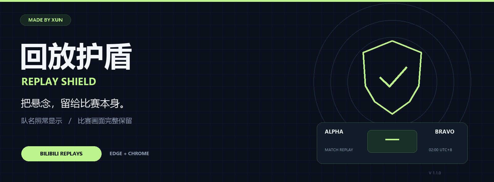
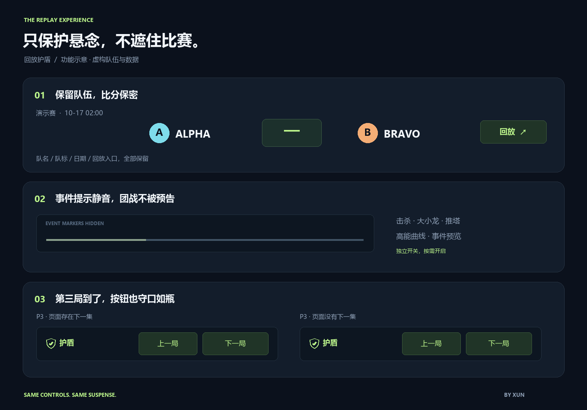

<p align="center">
  
</p>

<h1 align="center">回放护盾 <sup>Replay Shield</sup></h1>

<p align="center">
  <strong>睡醒再看，也值得拥有直播般的悬念。</strong><br>
  一个为 B 站英雄联盟赛事回放而做的轻量浏览器扩展。<br>
  队名照常显示，比赛画面完整保留，让页面上的结果先保密。
</p>

<p align="center">
  
  
  
  
</p>

<p align="center">
  <a href="#-一分钟开始">快速安装</a> ·
  <a href="#-把这些剧透线索收起来">功能一览</a> ·
  <a href="docs/INSTALL.md">使用说明</a> ·
  <a href="CHANGELOG.md">更新日志</a>
</p>

---

## ◈ 为回放党留住悬念

凌晨两点开赛，早上起来看回放。还没点开视频，赛程里的 **3 : 0** 就先告诉了你结局；进度条上的事件图标提前预告团战，第三局突然消失的“下一集”按钮，又暴露了系列赛已经结束。

**回放护盾把这些页面线索藏起来。** 你依然知道是哪两支队伍、哪一场比赛，照常使用 B 站原有的回放入口，也能完整看到比赛画面。

<p align="center">
  
  <br><sub>效果示意 · 使用虚构队伍与数据，并非真实赛事截图。</sub>
</p>

## ◈ 把这些剧透线索收起来

| 页面上的线索 | 护盾开启后 |
| :--- | :--- |
| **赛程比分、胜方高亮** | 比分显示为 `—`，胜负颜色统一；队名、队标、时间与回放按钮保留。 |
| **标题、评论、推荐和弹幕** | 可一键隐藏周边内容，减少结果提前出现在眼前的机会。 |
| **进度条事件图标、高能曲线** | 独立隐藏击杀、龙、塔等事件标记层和预览提示。 |
| **“下一集”消失、选集总数** | 一律隐藏原生切集按钮和选集数量，提供始终同样显示的切局入口。 |
| **进度和总时长** | 可隐藏播放器时长与进度，通过快进、快退和倍速继续操作。 |

> **画面完整，队名保留。** 本版没有视频遮挡块，也不隐藏参赛队伍。保护范围是页面比分与播放器周围的剧透提示。

## ◈ 一分钟开始

### 01 · 下载源码

在本仓库点击 **Code → Download ZIP**，解压到一个准备长期保留的文件夹。

### 02 · 加载扩展

| 浏览器 | 在地址栏打开 |
| :--- | :--- |
| Microsoft Edge | `edge://extensions` |
| Google Chrome | `chrome://extensions` |

打开 **开发人员模式** → **加载解压缩的扩展** → 选择本项目的 **`extension` 文件夹**。该文件夹内应直接包含 `manifest.json`。

### 03 · 刷新，开始看回放

刷新已经打开的 B 站页面，进入 [英雄联盟官方赛事页](https://live.bilibili.com/6)，按队名与日期找到比赛，点击原来的 **回放**。

点击右下角绿色 **「◈ 护盾」** 调整设置；也可以从浏览器工具栏打开扩展面板。

<details>
<summary><strong>从旧版升级</strong></summary>

用新版 `extension` 内容覆盖原安装目录 → 在扩展管理页点击 **重新加载** → 刷新 B 站页面。

v1.1.0 已移除队名隐藏和视频画面遮挡。旧的遮挡设置不会继续启用；周边隐藏的开关偏好仍会保留。新增的事件图标保护和总局数保护默认开启。

</details>

## ◈ 三个开关，刚好够用

| 开关 | 控制什么 |
| :--- | :--- |
| **隐藏周边剧透** | 标题、简介、推荐、评论、网页弹幕、进度与总时长。 |
| **隐藏进度条事件提示** | 独立的赛事事件图标、高能曲线、章节与事件预览。 |
| **隐藏总局数线索** | 原生上 / 下一集、选集列表、选集菜单和结束推荐。 |

三个开关分别生效，设置保存在本机，在已打开的匹配页面间同步。

### 切局按钮不会抢先告诉你结局

护盾面板的 **上一局 / 下一局** 始终保持相同文字和可点击状态，不因最后一局而变灰或消失，也不显示总集数。点击时使用页面实际存在的分集入口；缺少入口时不会拼出越界地址或跳转。

它消除的是“按钮消失”这条提前泄露的线索；已经看完的比赛内容，以及实际切局后没有新内容，仍然可能让人判断比赛已经结束。

### 保留日常播放操作

`播放 / 暂停` · `−15 秒` · `＋15 秒` · `＋2 分钟` · `1× / 1.25× / 1.5× / 2×`

**临时显示页面比分** 会显示 10 秒，再自动恢复；这不会解除事件图标和总局数保护。

## ◈ 轻装运行

<table>
<tr>
<td width="33%" valign="top"><strong>本机保存</strong><br><br>不需要账号或服务端。设置保存在浏览器本地。</td>
<td width="33%" valign="top"><strong>权限简单</strong><br><br>只声明 <code>storage</code> 权限，在指定 B 站页面运行。</td>
<td width="33%" valign="top"><strong>源码直接加载</strong><br><br>原生 HTML、CSS 和 JavaScript，无需构建即可安装。</td>
</tr>
</table>

扩展代码不收集账号、Cookie 或浏览历史，不上传数据。播放、登录、切局和清晰度切换仍由 B 站本身处理，正常产生 B 站的网络请求。

## ◈ 预览与开发

**离线预览：** 下载源码后，双击打开 [`demo/index.html`](demo/index.html)。演示使用虚构队伍、合成画面和与扩展相同的保护代码，不包含真实赛果，也不会跨页面保护 B 站。

```text
replay-shield/
├─ extension/          浏览器直接加载的扩展
├─ demo/               可离线打开的交互演示
├─ docs/               使用指南、验证记录与展示素材
├─ tests/              30 项 DOM 与逻辑回归检查
├─ scripts/            检查与本地打包脚本
├─ CHANGELOG.md        版本变化
└─ README.md           你正在看的这一页
```

开发检查需要 Node.js 22 或更新版本：

```bash
corepack pnpm install --frozen-lockfile
corepack pnpm test
```

本地打包：

```bash
corepack pnpm run package
```

打包脚本只生成本地 ZIP，**不会创建 GitHub Release、上传扩展商店或公开仓库**。

## ◈ 适用范围

- 适用于电脑端 Edge / Chrome 的匹配 B 站赛事页和回放页，不支持手机 B 站 App。
- 已通过 **30 项 DOM 与逻辑检查**；完整真实回放、账号状态与播放器全屏尚未完成实测确认。
- 页面改版、图片里烧录的比分、搜索 / 动态页面和新的弹幕组件，可能需要额外适配。
- 所有队名按设计保留，后续晋级对阵中的队伍身份也保持可见。

详细范围和依据见 [使用说明](docs/INSTALL.md) 与 [验证记录](docs/VERIFICATION.md)。

---

<p align="center">
  <br>
  <strong>回放护盾 · Replay Shield</strong><br>
  <sub>Designed & built by <a href="https://github.com/LuoLee7"><strong>Xun</strong></a> · © 2026 Xun</sub><br>
  <sub>独立作品，与 Bilibili、Riot Games 或英雄联盟官方无隶属关系。</sub>
</p>
